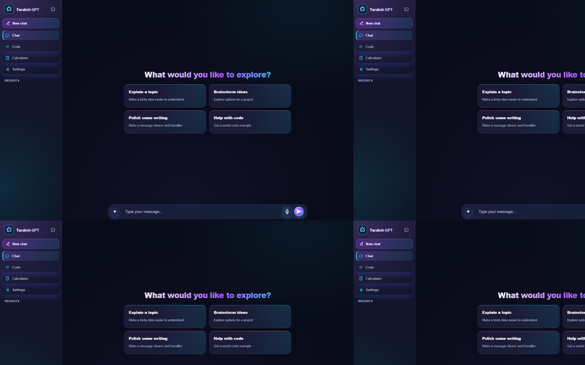
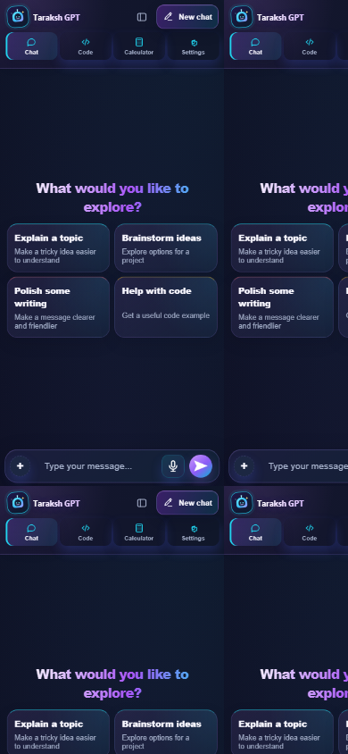

# Taraksh's Chatbot

A browser-based AI assistant for chat, coding, web searches, weather updates, image previews, voice input, calculations, and conversation history. The project is a lightweight static website built with HTML, CSS, and vanilla JavaScript.

## Features

- **Smart chat mode** powered by Groq
- **Normal mode** with built-in browser responses and web search helpers
- **Code workspace** for HTML, JavaScript, and Python
- **Code execution** for browser JavaScript, HTML previews, and Python through Pyodide
- **Code Agent** that can review, explain, improve, or write code directly into the editor
- **Calculator** with keyboard-friendly controls
- **Weather updates** using Open-Meteo
- **Web search** using DuckDuckGo
- **Image understanding, previews, and text-to-image generation**
- **Voice input** and text-to-speech replies where supported by the browser
- **Conversation history** with AI-generated titles for Smart mode chats, summaries, likes, plain-text and Markdown downloads, print-ready PDF export, themes, fonts, and message customization
- **Collapsible sidebar** with icon-led workspace shortcuts, a New chat action, and a scrollable Recents list with per-chat deletion
- **Guest mode** with conversations saved in this browser
- **Clerk sign-in** with per-account conversation history stored in Cloudflare D1
- **Up to 1,000 saved chats** per guest browser or signed-in account

## Screenshots

| Desktop | Mobile |
| --- | --- |
|  |  |

## How the app is built

The project is a static, browser-first application with a small server-side proxy:

- **Frontend:** `index.html` contains the page markup, styles, and vanilla JavaScript. It manages the interface, chat state, local guest storage, exports, browser features, and calls to external services. There is no bundler or compile step.
- **Public configuration:** `config.js` supplies the deployed Worker URL and Clerk publishable key. These values are visible to website visitors and must never contain private API keys or secrets.
- **Backend:** `worker.js` runs on Cloudflare Workers. It proxies Smart mode requests to Groq, generates images with Workers AI, verifies Clerk session tokens, and accesses D1 for account history.
- **Account database:** `schema.sql` defines the D1 tables for Clerk users and saved chats.
- **Deployment configuration:** `wrangler.toml` names the Worker and declares its `CHAT_HISTORY` D1 and `AI` Workers AI bindings.

### Request and data flow

| Feature | Flow |
| --- | --- |
| Smart chat and AI titles | Browser → `POST /` on the Worker → Groq Chat Completions API; text chat can use Groq browser search for fresh information |
| Image understanding | Browser resizes and compresses the image → Worker → Groq vision model |
| Image generation | Browser → `POST /api/images/generate` → Cloudflare Workers AI (`@cf/black-forest-labs/flux-1-schnell`) |
| Clerk sign-in | Browser → Clerk JavaScript SDK; browser sends a Clerk session token to the Worker for verification |
| Signed-in history | Browser → Worker `/api/chats...` → Cloudflare D1, scoped to the verified account |
| Guest history | Browser → this browser's `localStorage`; it is not uploaded unless the user signs in and history migration runs |
| Normal-mode web search and weather | Browser → DuckDuckGo and Open-Meteo |
| Python | Browser downloads Pyodide when Python execution is used |

The Worker applies the configured `ALLOWED_ORIGIN` check to API requests and returns CORS headers for approved origins. Browser code does not receive the Groq API key or Clerk secret key.

### Main interface and conversation behavior

- The sidebar can collapse and expand; its state is retained in browser storage. **Recents** has its own scroll area so a long history does not push other navigation offscreen. The scrollbar is hidden visually while scrolling remains enabled.
- Starting a chat creates a separate conversation ID. Recent sessions are sorted by last update and can be reopened or deleted. Deletion asks for confirmation.
- Guest chats are stored locally. Signed-in chats are stored in D1 and can be loaded on another device after sign-in. Existing guest chats are migrated to the account on sign-in.
- Each guest browser and each signed-in account can save up to **1,000 chats**. At the limit, creating another chat is blocked and the app asks the user to delete a session from Recents. Paid upgrades are not currently available. The Worker enforces the account limit when saving, including concurrent create attempts.
- In Smart mode, after the first exchange the app makes a separate Groq request to create a concise session title. If title generation fails, the first prompt is used as a fallback; old chats with that fallback title retry title generation when opened in Smart mode. Normal mode does not request AI titles.
- Markdown tables and inline formatting in assistant replies are rendered in the chat. The application stores message content so history can be restored and exported.
- TXT and Markdown exports download the current conversation. PDF uses the browser print dialog; choose **Save as PDF**. Generated images are included in saved history and supported exports.
- The Code workspace can run JavaScript in the browser, show HTML previews, load Pyodide for Python, and use the Code Agent to explain, review, fix, or create code in the editor.
- Voice recognition, speech synthesis, Python, image understanding, and network-backed services depend on browser support and connectivity. Image understanding requires the configured Worker and Groq vision-model availability.

### Saved data and limits

- A chat record contains an ID, title, messages, and creation/update timestamps. Messages store a role and text, optional feedback, and optional generated-image data.
- The Worker accepts at most 500 messages per chat and 750,000 UTF-8 bytes of serialized messages per chat. Generated JPEG data URLs are limited to 160,000 characters each by the Worker; the browser compresses generated images to a smaller size before saving.
- The 1,000-chat limit is a count limit, not a promise that a browser's storage quota can hold 1,000 large chats. Browser storage may run out earlier, especially for image-heavy conversations.
- The Worker verifies Clerk-signed session tokens against the Clerk instance's public signing keys before accessing account history.

## Groq configuration

The app sends Smart mode requests to the configured Cloudflare Worker, which proxies them to:

`https://api.groq.com/openai/v1/chat/completions`

Smart text chat uses `openai/gpt-oss-20b`, which supports Groq's built-in browser search and is currently the lowest-priced publicly listed production model with that capability ($0.075 per million input tokens and $0.30 per million output tokens; see [Groq's current model pricing](https://console.groq.com/docs/models)). Browser search is enabled for text chats, and the model uses it when the question needs current information. Image understanding uses a separate vision-capable model. Do not put a Groq key in `index.html`, GitHub Pages, or `config.js`. Deploy `worker.js`, store the key in the Worker secret `GROQ_API_KEY`, and set only the proxy URL in `config.js`.

The Worker forwards the model, messages, temperature, and completion-token settings it needs. It does not expose the Groq credential to the browser.

## Image generation

In chat, ask for an image (for example, **“Generate an image of a dog”**). The Worker uses Cloudflare Workers AI with `@cf/black-forest-labs/flux-1-schnell`; `wrangler.toml` configures the required `AI` binding. If deploying from the Cloudflare dashboard, add a **Workers AI** binding named `AI` under the Worker’s **Settings → Bindings**, then deploy.

Workers AI currently includes a free daily allocation of 10,000 Neurons. Requests beyond that allocation may require a paid Workers plan; check [current pricing](https://developers.cloudflare.com/workers-ai/platform/pricing/). Image prompts are sent to Cloudflare, and generated images are compressed and saved with the conversation.

## GitHub Pages deployment, step by step

1. Create a replacement key in the Groq console. Do not share or paste it into GitHub.
2. Open Cloudflare Dashboard, then go to **Workers & Pages**.
3. Select **Create**, **Start with Hello World**, and name the Worker `taraksh-gpt-groq-proxy`.
4. Open the Worker editor, replace the example code with the contents of `worker.js`, add the Workers AI binding named `AI` under **Settings → Bindings**, and deploy it.
5. Open **Settings**, **Variables and Secrets**, and add a secret named `GROQ_API_KEY` with the replacement key as its value.
6. Add a plain variable named `ALLOWED_ORIGIN` with your exact GitHub Pages origin, for example `https://taraksh9123-droid.github.io`. Do not include a path or trailing slash.
7. Copy the Worker URL, which normally looks like `https://taraksh-gpt-groq-proxy.<account-subdomain>.workers.dev`.
8. In this repository, create `config.js` from `config.example.js` and set `GROQ_PROXY_URL` to the Worker URL.
9. Commit and push `config.js` and `index.html`. `config.js` contains public configuration only; never put `GROQ_API_KEY` or `CLERK_SECRET_KEY` in it.
10. In GitHub, open **Settings**, **Pages**, and deploy from the repository branch if Pages is not already enabled.
11. Open the GitHub Pages site and test Chat in Smart mode.

If Groq reports that a key is invalid or revoked, create a replacement key and update only the Cloudflare `GROQ_API_KEY` secret. Redeploy is not required.

## Cloudflare history and Clerk sign-in

Each **New chat** creates a separate conversation session with its own ID, title, and messages, shown in the sidebar like ChatGPT chat history. Guest sessions stay in browser storage. Clerk accounts sync their sessions to D1, keyed by Clerk's stable user ID; the client never supplies an owner ID for history operations. The Worker verifies Clerk-signed session tokens before allowing history access.

Guest history in this browser and each signed-in account support up to 1,000 saved chats. At the limit, starting another chat is blocked with a notice to delete a conversation from **Recents**. Paid upgrades are not currently available.

Clerk manages its own browser session and token renewal. The app does not persist Clerk tokens in its own local storage or create a separate app sign-in cookie.

Configure Clerk and the Worker:

1. Use the Dashboard-selected Clerk application and choose the sign-in methods enabled for your users. Leave Google/GitHub providers disabled in Clerk if you want to remove those methods entirely.
2. Copy the Clerk **Publishable key** into `window.CLERK_PUBLISHABLE_KEY` in `config.js`.
3. In Cloudflare Worker **Settings → Variables and Secrets**, set `CLERK_ISSUER` to the HTTPS issuer URL for your Clerk instance (for example, `https://your-instance.clerk.accounts.dev`). Keep `CLERK_SECRET_KEY` private if you configure it for other Clerk integrations; this Worker verifies JWTs with Clerk's public keys and does not need the secret key.
4. In Cloudflare, create a D1 database, run all SQL from [`schema.sql`](./schema.sql), and bind the database to the Worker as `CHAT_HISTORY` under **Settings → Bindings**.
5. In Worker **Settings → Variables and Secrets**, set `ALLOWED_ORIGIN` to the exact site origin (comma-separated if using multiple sites), with no path or trailing slash. Keep `GROQ_API_KEY` as a Worker secret.
6. Deploy the updated `worker.js` and publish `index.html` and `config.js`. Test Clerk sign-in and chat-history sync from the deployed HTTPS site.

Clerk controls which identity providers and sign-in methods are available in its hosted UI. Guest mode and other chat tools continue to work. Existing guest chats are copied to the account after sign-in. Previous Google/GitHub account records remain in D1 but are not automatically linked to Clerk users. Signing out leaves account history on the server and returns to local guest history.

## Code Agent

Open the **Code** tab to use the Code Agent:

1. Write a prompt in the agent sidebar.
2. Click **Ask agent**.
3. Ask for explanations, fixes, improvements, or new code.
4. When the request generates code, the result is placed directly in the editor.

Use **Run code** to execute the current editor contents, or **Check code** for a focused review.

## Deployment

This is a static site and can be deployed with GitHub Pages or any static hosting provider. The included `robots.txt` and `sitemap.xml` support search engine discovery for the published GitHub Pages site.

For GitHub Pages:

1. Push the repository to GitHub.
2. Open **Settings → Pages**.
3. Select the deployment branch and repository root.
4. Open the generated site URL.

For local development, open `index.html` in a browser. Normal mode and guest history can be explored without a build step. Smart chat, generated images, Clerk sign-in, and account history require a reachable, correctly configured Worker. A `file://` preview is not a substitute for testing the published HTTPS site because browser origin checks differ.

There is no package manager manifest or bundled automated test suite. Before publishing Worker changes, run `node --check worker.js`; also test the affected flow from the deployed site. Python execution may download runtime files on first use.

## Privacy and limitations

- Read the [Privacy Policy](./privacy.html) and [Terms of Service](./terms.html) for the app's data practices and usage terms.
- Chat requests in Smart mode are sent to Groq.
- Smart text chat can use Groq's built-in browser search (powered by Exa) for current information; normal-mode web searches use DuckDuckGo.
- Attached images and their prompts are sent through the configured Worker to Groq for image understanding.
- Smart mode sends the first user message and assistant reply to Groq once more to generate a concise title. Older chats whose title still matches the first prompt retry title generation when opened in Smart mode; if generation fails, the first prompt remains the fallback.
- Signed-in chat transcripts are stored in the configured Cloudflare D1 database. Guest transcripts remain in this browser's local storage.
- Image prompts are processed by Cloudflare Workers AI, and generated images are saved with their conversations.
- Clerk authenticates users; the Worker verifies Clerk session tokens and scopes D1 access to the verified Clerk account.
- Search requests are sent to DuckDuckGo.
- Weather requests are sent to Open-Meteo.
- Voice, speech, image, and Python features depend on browser support and network availability.
- Browser local storage can be cleared by resetting settings or clearing site data.

## Project files

```text
index.html                     Complete UI, styles, and browser-side application logic
worker.js                      Cloudflare Worker API proxy, image generation, Clerk token verification, and chat-history routes
config.js                      Public Worker URL and Clerk publishable key for this deployment
config.example.js              Safe template for public frontend configuration
wrangler.toml                  Worker name, D1 binding, Workers AI binding, and compatibility date
schema.sql                     D1 users and chats tables and indexes
README.md                      Setup, architecture, deployment, privacy, and feature documentation
favicon.svg                    Scalable site icon
favicon.png                    PNG site icon for browser compatibility
screenshots/                   Desktop and mobile interface screenshots
robots.txt                     Search crawler rules
sitemap.xml                    Public-site sitemap
privacy.html                    Public privacy policy for Clerk sign-in and app data
terms.html                      Public terms of service
google0ae9b6fc5df16510.html     Google site-verification file
```

`config.js` is deployment-specific and should be reviewed before publishing. It may contain public URLs and Clerk's public publishable key only; it must not contain `GROQ_API_KEY`, `CLERK_SECRET_KEY`, or other credentials.

## Author

Created by [Taraksh Choudhary](https://github.com/taraksh9123-droid).
